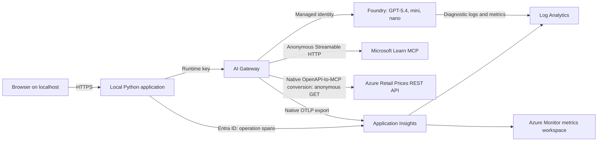

# AI Gateway Playground

## Overview

Test model access, routing, request limits, and MCP tools through Azure AI Gateway.
Inspect prompts, answers, HTTP exchanges, and native monitoring from a local HTTPS application.

Run `azd up` to create a dedicated resource group with AI Gateway, a Microsoft Foundry account,
three new model deployments, Log Analytics, and Application Insights.
Each environment owns its models. The deployment does not connect to existing model deployments.
The application runs on your Windows computer, not on an Azure host.

Use the **MCP tools** page to run two cases through your standalone AI Gateway:
connect to the remote Microsoft Learn MCP server, and call the Azure Retail Prices REST API as an MCP tool.
Microsoft hosts both public backends. Neither call uses a Foundry model.

Use the [user guide](USER-GUIDE.md) for the experiments and [concepts guide](CONCEPTS.md) for the request path.
This independent project is not an official Microsoft product.

## Architecture

The gateway applies access policies and routes model requests to the environment's models.
It also fronts `https://learn.microsoft.com/api/mcp` and exposes
`https://prices.azure.com/api/retail/prices` as the read-only MCP tool `get_azure_retail_prices`.
The gateway performs the OpenAPI conversion without a custom proxy.
Its managed identity authenticates to Foundry and the telemetry destination.
The local server uses your signed-in Azure identity for management and monitoring.
It keeps Azure tokens and gateway keys out of the browser.
Azure provisions the native telemetry collection resources in a managed resource group linked to Application Insights
when the setup hook enables OTLP ingestion.

## Prerequisites

| Requirement | Minimum version or condition |
|---|---|
| Windows | Windows 11 for the local application and certificate store |
| [PowerShell](https://learn.microsoft.com/powershell/scripting/install/installing-powershell) | 7 |
| [Python](https://www.python.org/downloads/windows/) | 3.11, Windows x64; install x64 Python on ARM64 computers too |
| [Azure Developer CLI](https://learn.microsoft.com/azure/developer/azure-developer-cli/install-azd) | 1.37.0 |
| [Azure CLI](https://learn.microsoft.com/cli/azure/install-azure-cli) | 2.92.0, for infrastructure development and the legacy runner |
| [Bicep](https://learn.microsoft.com/azure/azure-resource-manager/bicep/install) | 0.48.1 for local infrastructure validation |
| Local HTTPS certificate | Trusted, exportable `CN=localhost` certificate in the current Windows user's certificate store |
| Azure subscription | AI Gateway access and model quota in your selected location |

Use a location that supports AI Gateway, native OTLP ingestion, and all three models.
The preprovision hook checks model versions, SKUs, and available quota in that location.
It requires 10 capacity units each for GPT-5.4, GPT-5.4-mini, and GPT-5.4-nano with `GlobalStandard`.
Quota availability can change before provisioning finishes.
`GlobalStandard` does not restrict inference processing to the resource's location.

To create the resource group, your deployment account needs **Contributor** at subscription scope.
It also needs **Role Based Access Control Administrator**, **User Access Administrator**, or **Owner**
at the scopes where setup assigns roles. Owner at subscription scope covers both requirements.
The subscription must have the resource providers registered and permit the preview APIs.

The launcher uses an existing trusted certificate. It does not create certificates or change trust.
Prepare the certificate as part of your workstation prerequisites.
Python dependencies come from your configured package source.
The bootstrap creates `.venv` and installs the pinned lock file.
On Windows ARM64, it uses an installed x64 Python runtime registered with the Python launcher.

## Getting started

1. Install the prerequisites.
2. Sign in with `azd auth login`.
3. Run `azd up` from the repository root. Answer the environment, subscription, and location prompts.
4. Run `pwsh .\scripts\start-presenter.ps1` and use the browser tab that it opens.

Keep the server terminal open.
The deployment hooks configure the model aliases, limits, both MCP cases, routing, and native telemetry.
They write the application settings and state under `.azure/<environment>/`, which Git ignores.
The launcher uses the selected azd environment.
Run `azd up` again to update that environment.

## Monitoring

Open the **Resources** page in the application for links to the environment's monitoring resources.
Use **Check Setup** to test model access, request limits, MCP, routing, and native activity/token reporting.

| View | What to inspect |
|---|---|
| Application Insights, Application Map | The local application's `ai-gateway-playground-presenter` operation spans |
| Application Insights, transaction search | Local operations; inspect gateway Server spans in `OTelSpans` |
| Log Analytics | Foundry diagnostics and gateway activity scoped to this Application Insights resource |
| Application, Monitoring page | Native token counters and model cost from the linked metrics workspace |

Native token and cost values are the latest cumulative samples within one hour.
They are not hourly spend or billing totals.
Gateway cost estimates exclude gateway charges.
Treat **Not reported** as missing data, not zero cost.
Cloud payload capture stays disabled.
Request and response evidence stays in the local server's memory for the session.

Model experiments call model deployments through the gateway. The two MCP cases call their public backends.
The solution creates no Foundry project or agent, so there is no Foundry agent trace view.

## Identities and roles

| Identity | Type | Role | Scope | Reason and narrower option |
|---|---|---|---|---|
| Gateway | System-assigned managed identity | Cognitive Services OpenAI User | Owned Foundry account | Invoke the three models. Account scope covers the shared model provider without access to other accounts. This built-in role also permits model metadata reads. |
| Gateway | Managed identity | Monitoring Metrics Publisher | Application Insights and its native Data Collection Rule | Send telemetry. The native OTLP endpoint requires the rule assignment; neither assignment grants access to other destinations. |
| Local developer | Human | Monitoring Metrics Publisher | Application Insights | Send local operation spans with Entra ID. Reader roles cannot ingest telemetry. |
| Deployment account | Human | Contributor plus a role-assignment administrator role | Subscription for group creation; owned resources for setup | Create and configure the environment and its role assignments. Subscription-level group creation cannot use a resource group role before that group exists. |
| Monitoring reader | Human | Log Analytics Reader and Monitoring Reader | Owned log and metrics workspaces | Read logs and native metrics without write access. The deployment account's existing management roles cover these reads; setup does not grant another subscription-wide role. |

Foundry and Application Insights reject key-based authentication.
The gateway uses its system-assigned identity from the existing Bicep.
The prepared runtime requests use a gateway key, which the server obtains in memory.
An Azure-hosted application needs its own managed identity and browser sign-in design.
The Microsoft Learn and Azure Retail Prices backends accept anonymous requests.
They need no backend credentials, API keys, or extra Azure role.
Gateway credential enforcement still applies to callers of both MCP cases.

## Clean up

Run `azd down --purge` from the repository root.
Review the selected environment before confirming.
This deletes the environment's resources and purges supported soft-deleted resources.
The postdown hook removes only that environment's generated local gateway configuration and state.
Other environments and existing model deployments remain unchanged.

## Known limitations

| Limitation | Production alternative |
|---|---|
| AI Gateway and native OTLP features use preview APIs. | Check the [current resource contract](https://learn.microsoft.com/azure/api-management/ai-gateway-resource), availability, pricing, and support requirements before deployment. |
| The application needs Windows and an existing trusted localhost certificate. | Host the application with managed HTTPS and Entra browser authentication. |
| Runtime requests share a gateway key that expires after three days. | Configure individual gateway identities and credential lifecycle management. |
| Request limits use an IP counter and can overshoot. | Design and test per-person or per-group allowances and financial controls. |
| Routing checks use healthy models. | Test backend outages before relying on failover. |
| AI Gateway does not support diagnostic settings. | Use its native OTLP exporter for activity, token, and cost monitoring. |
| Cloud payload capture is disabled; the local application displays model content. | Review privacy, access, redaction, and retention before enabling cloud content capture. |
| Retail Prices returns public list prices, not negotiated rates or bills. Each response contains at most 1,000 records and can include `NextPageLink`. | Choose service and location filters, inspect pagination, and use your billing data for account-specific charges. This tool is not a total monthly cost calculator. |
| The public Microsoft Learn and Retail Prices backends require no authentication and are free to call. Azure gateway, model, and telemetry usage remains billable. | Review prices, quotas, ingestion, and retention for your selected configuration. |

See the [Microsoft Learn MCP overview](https://learn.microsoft.com/training/support/mcp),
[Learn tool discovery reference](https://learn.microsoft.com/training/support/mcp-developer-reference),
and [Azure Retail Prices API reference](https://learn.microsoft.com/rest/api/cost-management/retail-prices/azure-retail-prices)
for backend access, tools, filters, and pagination.
The native configuration follows the
[AI Gateway tool server resource contract](https://learn.microsoft.com/rest/api/aigateway/ai-gateway-tool-server-resources/create-or-update?view=rest-aigateway-2026-11-01).

## Troubleshooting

If quota preflight fails, select a location with capacity or request quota.
The hook does not switch your location or reuse another account's deployments.
If setup fails after provisioning, fix the reported error and run `azd up` again.
Azure sign-in remains a separate user action; the hooks never start an interactive sign-in.

If the launcher reports a certificate error, stop and check the workstation certificate prerequisite.
Do not bypass TLS validation.
Keep `.azure` private because it contains deployment identifiers and local diagnostics.
